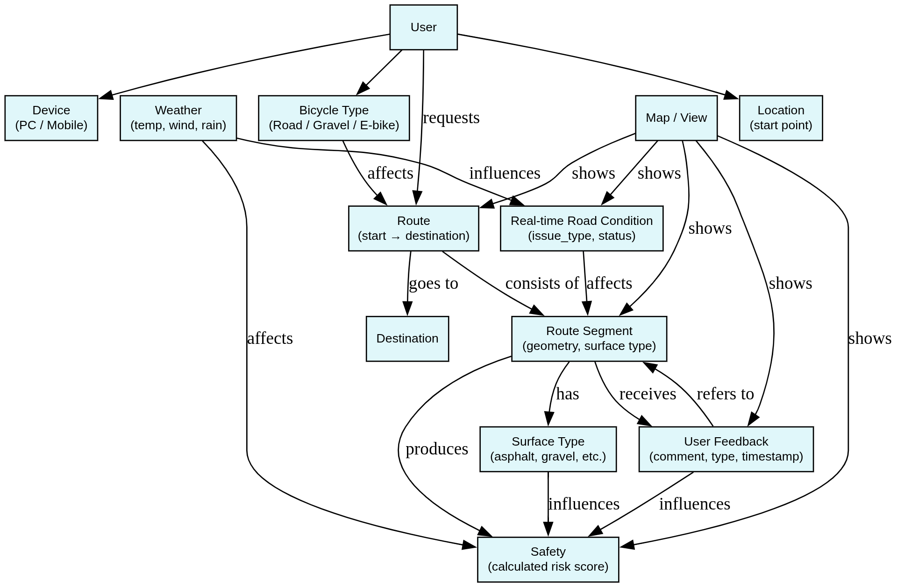
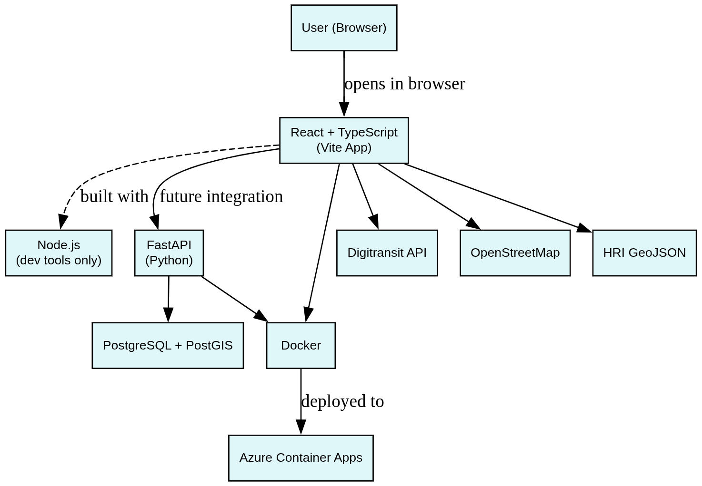
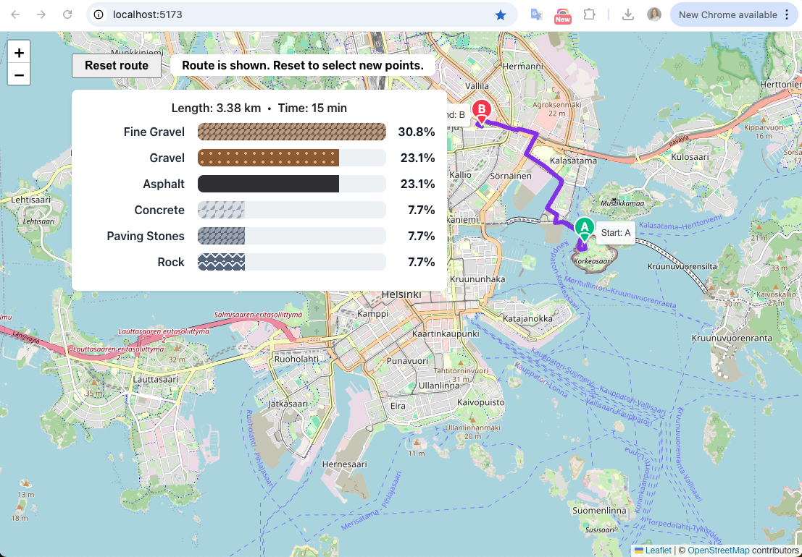

# bike-route-map

A web application that helps cyclists find safer and more comfortable bike routes,  
with surface type visualization and smart routing using open data.

---

## 1. Features

- Surface type map (asphalt, gravel, cobblestone, etc.)
- Route planning between A → B (via Digitransit API)
- Route surface type breakdown (percentages)
- (Optional) User feedback for segments

---

## 2. Tech Stack

- **Frontend:** React + Leaflet + Vite  
- **Backend:** FastAPI (Python) — local service, Dockerized for development  
- **Database:** PostgreSQL + PostGIS — *(planned)*  
- **GIS:** Location and surface data via GeoJSON, ORS API, Overpass API  
- **Deployment:** Azure Static Web Apps (frontend), Docker Compose (local backend), Azure Containers *(planned)*

---

## 3. How to Run

### Frontend

Copy `.env.example` to `.env` if you do not already have a local configuration.
For live local routing, set `VITE_USE_SAMPLE=0` and
`VITE_API_BASE=http://localhost:8000`. Restart Vite after changing these values.
The development server uses port 5173 and stops if that port is occupied,
matching the backend's allowed local origins.

Set `VITE_USE_SAMPLE=1` to display the fixed demo route without a backend.
Demo mode is labeled on the map; metrics absent from the sample are not shown.
Live failures never fall back to the demo. The icy-dune build explicitly keeps
sample mode enabled until the cloud backend is connected in #41/#42.

```bash
# install dependencies
npm install

# start the development server (http://localhost:5173)
npm run dev

# build the production bundle
npm run build

# preview the production build locally
npm run preview

# frontend tests and TypeScript checks
npm test
npm run typecheck
```

### Backend (local without Docker)

```bash
# from project root
cd backend

# create and activate virtual environment
python3 -m venv .venv
source .venv/bin/activate   # Linux / macOS
# .venv\Scripts\activate   # Windows

# install dependencies
pip install -r requirements.txt

# set the server key in this terminal before starting live routing
export ORS_API_KEY=your_server_key_here

# run the FastAPI server
python -m uvicorn main:app --reload --port 8000
```

### Backend via Docker Compose

Requirements:
- Docker Desktop (or Docker Engine + Compose plugin)
- Port `${BACKEND_PORT:-8000}` available on host

```bash
# from project root
docker compose up --build backend
```

Backend docs: http://localhost:8000/docs

To use a different host port, set `BACKEND_PORT` in `.env` (see `.env.example`):

```bash
BACKEND_PORT=8010 docker compose up --build backend
```

```bash
# stop containers
docker compose down
```

The live frontend uses `POST /api/v1/route` on the backend. The ORS key belongs
only in the backend process environment, never in a `VITE_` variable. The local
Uvicorn command above inherits that environment; the current Compose file does
not yet forward the key into the container.

Route geometry, distance, time and surface data come from one backend result.
A partial result keeps the route and metrics and explains that surface coverage
is unavailable. Failed requests clear the previous result and offer a retry.
Reset cancels pending work. Surface chart rendering and segment coloring are
the next stage of #66; this stage displays the route and its metrics.

The map no longer calls the legacy `/analyze-surface` endpoint. For that endpoint's
errors, cache behavior, limitations and tests, see
[Surface API notes](backend/SURFACE_API.md).

---

## 4. Folder Structure

```
/src       → React components, map logic
/public    → Static files (e.g., GeoJSON, favicon)
/backend   → FastAPI backend (local + Docker)
/docs      → Diagrams, MVP notes, problem/solution domain docs
```

---

## 5. Docs

- [Problem Domain](docs/problem_domain.md)
- [Problem Domain Diagram](docs/ProblemDomain.png)
- [Solution Domain](docs/solution_domain.md)
- [MVP Description](docs/mvp.md) 
- [Solution Architecture](docs/TechStack.png)
- [Task List / TODO](TODO.md)

---

## 6. Problem Domain Diagram

> View or edit diagram: [https://is.gd/aFSsrB](https://is.gd/aFSsrB)



The Problem Domain diagram illustrates potential entities and relationships affecting bicycle route choice (e.g., surface type, weather, safety, and feedback). The current MVP focuses only on route geometry and surface data, while other factors are considered future scope.


---


## 7. Solution Domain Overview

> View or edit diagram: [https://is.gd/oo5vFi](https://is.gd/oo5vFi)

 

---

## 8. Project Tracker

For full task progress and status, see the  
[GitHub Project Board](https://github.com/users/VoxelPrincess/projects/3/views/1)

---

## PR Preview (Azure SWA)

This project uses **Azure Static Web Apps (SWA)** for pull request previews.  
Each pull request automatically creates a temporary preview environment.  
The preview URL is shown in the PR checks and disappears after the PR is merged.  

For deployment details, see [DEPLOY.md](./DEPLOY.md).

---

## 9. Deployment

### 11.1 — Frontend on Azure Static Web Apps

- **Resource:** `bike-frontend` (Free, Region: West Europe)  
- **Branch:** `main`  
- **App location:** `/` • **Output:** `dist` • **API:** *(empty)*  
- **URL:** https://icy-dune-080042c1e.3.azurestaticapps.net  
- **Notes:** SPA fallback via `staticwebapp.config.json` prevents 404 on deep links.

### 11.4 — Test Updates via Pull Request

Updates are tested through **pull requests**.  
Each PR triggers GitHub Actions → Azure SWA builds a **temporary preview environment**.  
The preview URL is shown in the PR checks and disappears after the PR is merged.

👉 For full deployment details, see [DEPLOY.md](./DEPLOY.md).

---

## Demo

- Local preview (screenshot):
  
  

- Video demo: [Watch on Google Drive](<https://drive.google.com/file/d/1LXbNfJVwOeqU_r5m7MkkzT5k7p-V8szH/view?usp=drive_link>)
